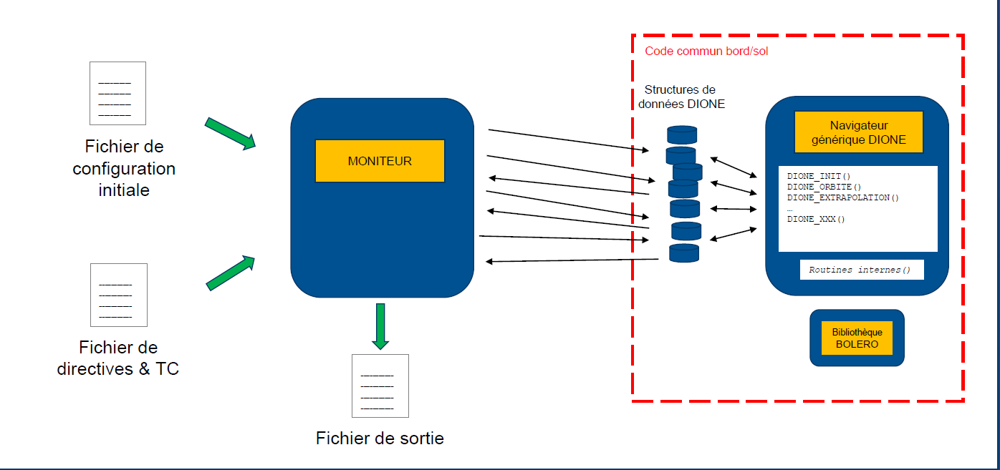

> __Customer__\: Centre National d'Études Spatiales (CNES)

> __Programme__\: Generic

> __Supply Chain__\: CNES >  CS Group SPACE

# Context

BOLERO is a mathematical library developed by CNES, since 2000, for on-board orbit determination in the Earth's vicinity. 
It is composed of a Kalman Filter, measurement functions such as GNSS measurements, and dynamical models. 
DIONE is a navigation system that employs the BOLERO library to compute the estimated trajectory as well as dynamical and measurement parameters.

CS Group responsabilities for Bibliothèque d'Objets Logiciels Embarqués pour la Restitution d'Orbite are as follows:
* Maintenance and evolutions of BOLERO &  DIONE
* Development of modules for vision-based navigation
* Coverage C-level criticity of the code
* Study analysis : simple difference GNSS measurements, real-time measurements simulator, R&T for interplanetary missions

The features are as follows:
* Computation of position based on dynamic models.
* Correction of computed "theroetical" position using GNSS measurements and estimators such as Kalman filters.
* Computation of the trajectory of a single or multiple satellites orbiting in formation.
* Usability for interplanetary missions.
* Vision-based navigation.

# Project implementation

The project objectives are as follows:
* Development, maintenance of BOLERO and DIONE.
* Study and R&T analysis.

The processes for carrying out the project are:
* V cycle

# Technical characteristics

The solution key points are as follows:
* BOLERO library + mathematical library
* DIONE : generic navigator with a set of commands
* MONITOR : customisation of DIONE for a specific mission
* Input configuration, directives and mission files
* Output trajectory files

The main technologies used in this project are:

{:class="table table-bordered table-dark"}
| Domain | Technology(ies) |
|--------|----------------|
|Hardware environment(s)|OVH server|
|Operating System(s)|Linux - Windows|
|Programming language(s)|C ; Bash|

{::comment}Abbreviations{:/comment}

*[CLI]: Command Line Interface
*[IaC]: Infrastructure as Code
*[PaaS]: Platform as a Service
*[VM]: Virtual Machine
*[OS]: Operating System
*[IAM]: Identity and Access Management
*[SIEM]: Security Information and Event Management
*[SSO]: Single Sign On
*[IDS]: intrusion detection
*[IPS]: intrusion prevention
*[NSM]: network security monitoring
*[DRMAA]: Distributed Resource Management Application API is a high-level Open Grid Forum API specification for the submission and control of jobs to a Distributed Resource Management (DRM) system, such as a Cluster or Grid computing infrastructure.
