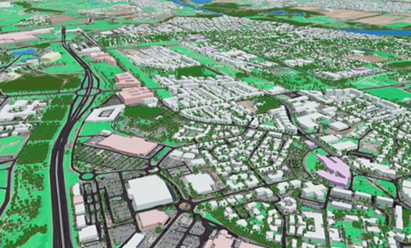
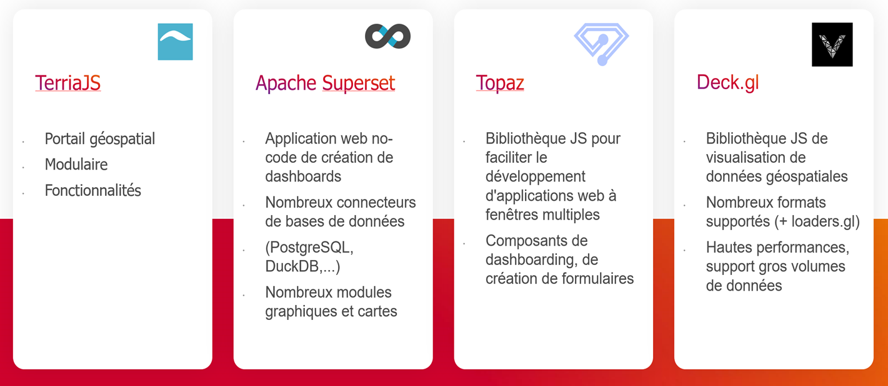

> __Customer__\: Centre National d'Etudes Spatiales (CNES)

> __Programme__\: CNES Digital Twin Factory

> __Supply Chain__\: CNES >  CS Group SPACE

# Context

A digital twin is a digital model of a physical system that enables the analysis of its past and present states, as well as the prediction of its future evolution. This study aims to develop a new user interface for Earth Digital Twins, integrated into a 3D web portal. The goal is to enhance visualization, analysis, and interaction with models. The project is based on various use cases (peri-urban areas, coastal zones, forests) and seeks to build a user community by promoting open-source solutions to encourage collaboration and innovation.

CS Group responsabilities for Cockpit DTF (Digital Twins Factory) are as follows:
* Design, development, intégration, studies

The features are as follows:
* Main features:  
* - Interface for selecting and analyzing variables,
* - Ability to create dynamic and customizable graphs,
* - Integration of processing algorithms,
* - Interface for launching processing and simulations,
* - Interface for building "What-If" scenarios,
* - Digital model editing,
* - Performance optimization to handle complex scenes,
* - Integration of real-time 3D engine.

# Project implementation

The project objectives are as follows:
* The project focuses on three main features:
* - Quantitative analysis,
* - Interaction with the digital twin,
* - Advanced graphical rendering.
* These improvements will facilitate the analysis, interaction, and visualization of digital twins.

The processes for carrying out the project are:
* Agile

# Technical characteristics

The solution key points are as follows:
* Client-server

The main technologies used in this project are:

{:class="table table-bordered table-dark"}
| Domain | Technology(ies) |
|--------|----------------|
|Hardware environment(s)|marker _ Cloud|
|Operating System(s)|marker _ Linux|
|Programming language(s)|marker _ JavaScript, Python|
|Interoperability (protocols, format, APIs)|marker _ OGC API processes, STAC, WMS|
|Production software (IDE, DEVOPS etc.)|marker _ TerriaJS, Superset, Thredds, Mapproxy|
|Main COTS library(ies)|marker _ Topaz, DeckGL, LoadersGL|

{::comment}Abbreviations{:/comment}

*[CLI]: Command Line Interface
*[IaC]: Infrastructure as Code
*[PaaS]: Platform as a Service
*[VM]: Virtual Machine
*[OS]: Operating System
*[IAM]: Identity and Access Management
*[SIEM]: Security Information and Event Management
*[SSO]: Single Sign On
*[IDS]: intrusion detection
*[IPS]: intrusion prevention
*[NSM]: network security monitoring
*[DRMAA]: Distributed Resource Management Application API is a high-level Open Grid Forum API specification for the submission and control of jobs to a Distributed Resource Management (DRM) system, such as a Cluster or Grid computing infrastructure.
