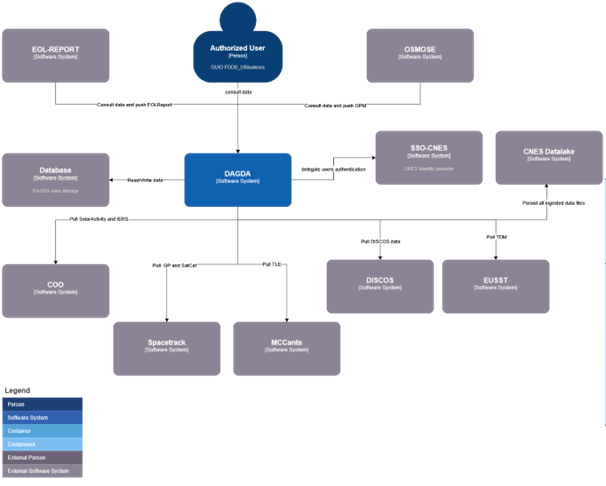

> __Customer__\: Centre National d'Etudes Spatiales (CNES)

> __Programme__\: SSA

> __Supply Chain__\: CNES >  CS Group SPACE

# Context

OSMOSE is part of a larger CNES ambition consisting in agregating and make consistant space surveillance data produced internally or coming from external sources.

CS Group responsabilities for DAtabase to Glean space DAta are as follows:
* Design, development, intégration, maintenance

The features are as follows:
* Main features: 
	* Space weather data retrieval 
	* Orbital data retrieval
	* Measurement retrieval (SSA)
	* Overall consistancy or retrieved space object identifiers
	* User rights and access management
	* Data consultation
	* Raw data consultation (original files)
	* Space events management

# Project implementation

The project objectives are as follows:
* DAGDA consists in exposing space surveillance data for CNES. Those data are produced either by the CNES itself or by external sources.

The processes for carrying out the project are:
* Agile (kanban)

# Technical characteristics

The solution key points are as follows:
* Decentralized

The main technologies used in this project are:

{:class="table table-bordered table-dark"}
| Domain | Technology(ies) |
|--------|----------------|
|Hardware environment(s)|PC (client)|
|Operating System(s)|Linux, Windows (client)|
|Programming language(s)|Java, PostgreSQL|
|Interoperability (protocols, format, APIs)|PostgREST (api REST), CCSDS|
|Production software (IDE, DEVOPS etc.)|Eclipse, IntelliJ, DBeaver, flyway DB, Mockito, Bruno|
|Main COTS library(ies)|PostgreSQL|

{::comment}Abbreviations{:/comment}

*[CLI]: Command Line Interface
*[IaC]: Infrastructure as Code
*[PaaS]: Platform as a Service
*[VM]: Virtual Machine
*[OS]: Operating System
*[IAM]: Identity and Access Management
*[SIEM]: Security Information and Event Management
*[SSO]: Single Sign On
*[IDS]: intrusion detection
*[IPS]: intrusion prevention
*[NSM]: network security monitoring
*[DRMAA]: Distributed Resource Management Application API is a high-level Open Grid Forum API specification for the submission and control of jobs to a Distributed Resource Management (DRM) system, such as a Cluster or Grid computing infrastructure.
