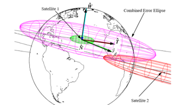

> __Customer__\: Centre National d'Études Spatiales (CNES-DTN-TSA-O2M)

> __Programme__\: Generic

> __Supply Chain__\: CNES-DTN-TSA-O2M >  CS Group SPACE

# Context

CS Group responsabilities for Operational maintenance & operation SCOOP for the CNES COO are as follows:
* 3 FTE; Delegation of tasks.

The features are as follows:
* Routine operations: Designation of stations, organization of passages; acquisition of location data; remained in orbit; user control center interfacing
* Operational Duty: Collision risk monitoring; operational emergency response
* Participation in critical exceptional operations: MIP; launch, post-injection; deorbit, reentries
* SCOOP software maintenance and COO intranet, COO site evolution

# Project implementation

The project objectives are as follows:
* Support to the COO team for the evolution and operation of the SCOOP (Operational Orbit Calculation System) orbitography processing chain operating the CNES 2 GHz station network.

The processes for carrying out the project are:
* V-Cycle

# Technical characteristics

The solution key points are as follows:
* Maintenance: stabilization of the platform's non-regression testing framework.
* MCO / operations support: service continuity, availability requests from CNES.
* CS GROUP expertise: space mechanics, operational software development/validation, software architecture, IT technologies.

The main technologies used in this project are:

{:class="table table-bordered table-dark"}
| Domain | Technology(ies) |
|--------|----------------|
|Hardware environment(s)|PC, station Linux, Terminaux X|
|Programming language(s)|Python, C, Bash, Fortran 77, Fortran 90, HTML, Javascript, SQL.|
|Production software (IDE, DEVOPS etc.)|Linux Redhat, Django , GIT, SCOOP, JAC, Site WEB COO, Word, Excel, Power Point.|

{::comment}Abbreviations{:/comment}

*[CLI]: Command Line Interface
*[IaC]: Infrastructure as Code
*[PaaS]: Platform as a Service
*[VM]: Virtual Machine
*[OS]: Operating System
*[IAM]: Identity and Access Management
*[SIEM]: Security Information and Event Management
*[SSO]: Single Sign On
*[IDS]: intrusion detection
*[IPS]: intrusion prevention
*[NSM]: network security monitoring
*[DRMAA]: Distributed Resource Management Application API is a high-level Open Grid Forum API specification for the submission and control of jobs to a Distributed Resource Management (DRM) system, such as a Cluster or Grid computing infrastructure.
