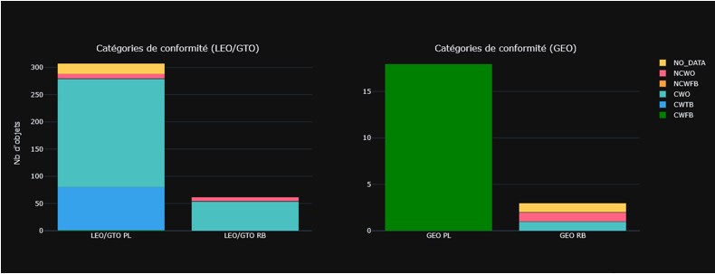
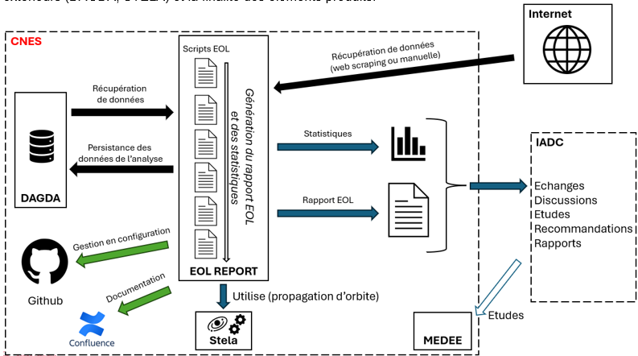

> __Customer__\: Centre National d'Etudes Spatiales (CNES)

> __Programme__\: SSA

> __Supply Chain__\: CNES >  CS Group SPACE

# Context

EOL REPORT is part of an European effort to assess LOS and european recommandations respect to ensure space sustainability. This report is due each year at the beginning of the year.

CS Group responsabilities for End of Life REPORT are as follows:
* Design, development, report production

The features are as follows:
* Main features: 
	* Retrieval of orbital and miscellaneous data from several sources (web scrapping, DAGDA)
	* Constellation automatic analysis
	* Other satellites manual analysis (with tools)
	* Results and statistics production
	* Result persistence (DAGDA)

# Project implementation

The project objectives are as follows:
* The EOL REPORT activy's goal is to produced every year a report on satellites ending their mission: the orbit is propagated in the future to estimate when they will deorbit. These information enable to production of statistics regarding LOS respect.

The processes for carrying out the project are:
* Kanban

# Technical characteristics

The solution key points are as follows:
* Monolithic

The main technologies used in this project are:

{:class="table table-bordered table-dark"}
| Domain | Technology(ies) |
|--------|----------------|
|Hardware environment(s)|PC (client)|
|Operating System(s)|Linux, Windows (client)|
|Programming language(s)|Python|
|Interoperability (protocols, format, APIs)|API REST (DAGDA), webscrapping|
|Production software (IDE, DEVOPS etc.)|TREX|

{::comment}Abbreviations{:/comment}

*[CLI]: Command Line Interface
*[IaC]: Infrastructure as Code
*[PaaS]: Platform as a Service
*[VM]: Virtual Machine
*[OS]: Operating System
*[IAM]: Identity and Access Management
*[SIEM]: Security Information and Event Management
*[SSO]: Single Sign On
*[IDS]: intrusion detection
*[IPS]: intrusion prevention
*[NSM]: network security monitoring
*[DRMAA]: Distributed Resource Management Application API is a high-level Open Grid Forum API specification for the submission and control of jobs to a Distributed Resource Management (DRM) system, such as a Cluster or Grid computing infrastructure.
