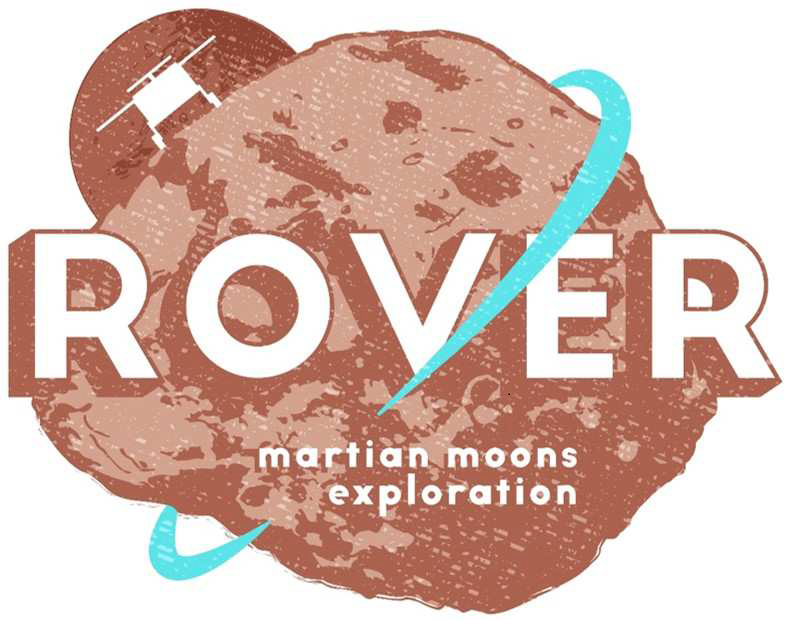

> __Customer__\: Centre National d'Etudes Spatiales (CNES)

> __Programme__\: MMX

> __Supply Chain__\: CNES >  CS Group SPACE

# Context

CS Group responsabilities for Support in Technical and Operational Qualification and Operations of FOCSE MMX rover are as follows:
* Piloting by CNES of TQ/OQ tests and support for MMX rover Operations

The features are as follows:
* **QT/OQ System Testing** : 
* Configuration, missionization and deployment of LP-ISIS, PULP, MIG versions 
* development of operational procedures and operational aids
* definition of detailed test plans, configuration: context management, requirements management, preparation and support for execution, analysis of results, investigation of technical facts and anomalies
* Maintenance of operational documentation
	**Operations Support** : 
* integrated resource in the CNES teams for the early phases of the rover's life (shifts, ground constraints)

# Project implementation

The project objectives are as follows:
* Support for carrying out the system qualification and Operations of the Ground Control Segments of the MMX rover implementing LP-ISIS
* Preparation and execution of qualification test campaigns 
* Production of operational data
* Carrying out operational procedures

The processes for carrying out the project are:
* Requirements management (STB, IF): JIRA
* Specific MMX Control Ground Segment Qualification Process
* Ground control segment qualification system tests: Compatibility, Technical and Operational Qualification

# Technical characteristics

The solution key points are as follows:
* Components and subsystems of the ISIS LP missionized for the FOCSE MMX
* PULP layer (the Unified Layer Package): base for missionization of the commons (procedures, infrastructure, etc.) of the LP-ISIS
* MIG mission: fictitious generic validation mission. Implementation of part of the ISIS operational concepts: procedures, automation

The main technologies used in this project are:

{:class="table table-bordered table-dark"}
| Domain | Technology(ies) |
|--------|----------------|
|Hardware environment(s)|Esx Dell, SAN, Appliance Netbackup, HP Thin Pro, switch, firewall|
|Operating System(s)|Red Hat 8, VMWare, NoMachine,  PXE|
|Programming language(s)|Python, Bash|
|Interoperability (protocols, format, APIs)|XML, XTCE, Json, CCSDS,  standard CNES XIF|
|Production software (IDE, DEVOPS etc.)|JIRA, CONFLUENCE, Git, Ansible|
|Main COTS library(ies)|Ldap, IDM, ZeroMQ, SGDB|

{::comment}Abbreviations{:/comment}

*[CLI]: Command Line Interface
*[IaC]: Infrastructure as Code
*[PaaS]: Platform as a Service
*[VM]: Virtual Machine
*[OS]: Operating System
*[IAM]: Identity and Access Management
*[SIEM]: Security Information and Event Management
*[SSO]: Single Sign On
*[IDS]: intrusion detection
*[IPS]: intrusion prevention
*[NSM]: network security monitoring
*[DRMAA]: Distributed Resource Management Application API is a high-level Open Grid Forum API specification for the submission and control of jobs to a Distributed Resource Management (DRM) system, such as a Cluster or Grid computing infrastructure.
