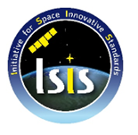

> __Customer__\: Centre National d'Etudes Spatiales (CNES)

> __Programme__\: ISIS

> __Supply Chain__\: CNES >  CS Group SPACE

# Context

CS Group responsabilities for Support in packaging of LP-ISIS ecosysteme are as follows:
* Piloting by CNES of support for LP-ISIS Packaging

The features are as follows:
* Configuration and deployment of software versions of LP-ISIS, PULP, MIG 
* Generic missionization of the LP-ISIS
* Modification of the deployment mechanisms (scripts and roles/ansible playbooks) of the different LP-ISIS targets
* Automation of installations/missionizations via Ansible
* Preparation and support for the execution of deployment non-regression tests
* Maintenance of documentation
* Support for the integration and missionization of impacted targets with user missions
* Development of example of use of the LP-ISIS scheduler (schedules, rules)

# Project implementation

The project objectives are as follows:
* Support for the creation and validation of the packaging of the LP-ISIS ecosystem
* Deployment of the different LP-ISIS targets
* Automation of installations
* Non-regression and qualification tests
* Support for the IVV of user missions

The processes for carrying out the project are:
* Continuous integration
* Specific IVV and Target Deployment Qualification Process

# Technical characteristics

The solution key points are as follows:
* LP ISIS components and subsystems,
* PULP layer (the Unified Layer Package): base for missionization of the commons (procedures, infrastructure, etc.) of the LP-ISIS
* MIG mission: fictitious generic validation mission. Implementation of part of the ISIS operational concepts: procedures, automation

The main technologies used in this project are:

{:class="table table-bordered table-dark"}
| Domain | Technology(ies) |
|--------|----------------|
|Hardware environment(s)|Esx Dell, SAN, Appliance Netbackup, HP Thin Pro, switch, firewall|
|Operating System(s)|Red Hat 8, VMWare, NoMachine,  PXE|
|Programming language(s)|Python, Bash|
|Interoperability (protocols, format, APIs)|XML, XTCE, Jason, CCSDS,  standard CNES XIF|
|Production software (IDE, DEVOPS etc.)|JIRA, CONFLUENCE, Git, Ansible|
|Main COTS library(ies)|Ldap, IDM, ZeroMQ, SGDB|

{::comment}Abbreviations{:/comment}

*[CLI]: Command Line Interface
*[IaC]: Infrastructure as Code
*[PaaS]: Platform as a Service
*[VM]: Virtual Machine
*[OS]: Operating System
*[IAM]: Identity and Access Management
*[SIEM]: Security Information and Event Management
*[SSO]: Single Sign On
*[IDS]: intrusion detection
*[IPS]: intrusion prevention
*[NSM]: network security monitoring
*[DRMAA]: Distributed Resource Management Application API is a high-level Open Grid Forum API specification for the submission and control of jobs to a Distributed Resource Management (DRM) system, such as a Cluster or Grid computing infrastructure.
