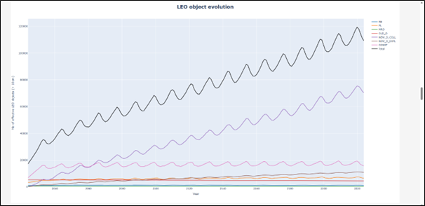

> __Customer__\: Centre National d'Etudes Spatiales (CNES)

> __Programme__\: SSA

> __Supply Chain__\: CNES >  CS Group SPACE

# Context

MEDEE is part of an international effort, led by the IADC (Inter-Agency Space Debris Coordination Committee) to evaluate the debris population's future and to regulate it as efficiently as possible. Several space agencies produce their own projections and compare them.

CS Group responsabilities for Modelling the Evolution of Debris in the Earth’s Environment are as follows:
* Design, development, intégration, studies

The features are as follows:
* Main features: 
	* Hypothesis handling : populations at start, explosion ratio, propagation models, ...
	* Data pre-processing and post-processing
	* CNES clusters use, plus statistics
	* Data in graphs, report production

# Project implementation

The project objectives are as follows:
* MEDEE is a tool used in debris population projections. Its goal is to foresee the debris population evolution considering several scenarios and hypothesis

The processes for carrying out the project are:
* Agile (kanban)

# Technical characteristics

The solution key points are as follows:
* Monolithic, calculations deported to CNES clusters; postprocessing and preprocessing are isolated in a separate project

The main technologies used in this project are:

{:class="table table-bordered table-dark"}
| Domain | Technology(ies) |
|--------|----------------|
|Hardware environment(s)|PC (client)|
|Operating System(s)|Linux, Windows (client)|
|Programming language(s)|Java, Python|
|Production software (IDE, DEVOPS etc.)|Eclipse, TRex|
|Main COTS library(ies)|Stela (CNES)|

{::comment}Abbreviations{:/comment}

*[CLI]: Command Line Interface
*[IaC]: Infrastructure as Code
*[PaaS]: Platform as a Service
*[VM]: Virtual Machine
*[OS]: Operating System
*[IAM]: Identity and Access Management
*[SIEM]: Security Information and Event Management
*[SSO]: Single Sign On
*[IDS]: intrusion detection
*[IPS]: intrusion prevention
*[NSM]: network security monitoring
*[DRMAA]: Distributed Resource Management Application API is a high-level Open Grid Forum API specification for the submission and control of jobs to a Distributed Resource Management (DRM) system, such as a Cluster or Grid computing infrastructure.
