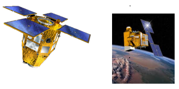
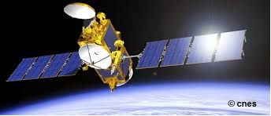

> __Customer__\: Centre National d'Études Spatiales (CNES)

> __Programme__\: Generic

> __Supply Chain__\: CNES >  CS Group SPACE

# Context

CS Group responsabilities for MAP_LEO are as follows:
* 12 engineers team
* Delegation of tasks with commitment of results for the exploitation of subsystems of spatial mechanics in satellite control centers under CNES responsibility

The features are as follows:
* Daily task monitoring
* Participation in coordination meetings
* Management of degraded cases with penalty 24/7
* Development and maintenance of additional tools
* Programming of maneuvers for posting and management of collision risks
* Support for the maintenance of operational software
* Participation in technical and operational qualification phases
* Drafting of operational procedures
* Preparation and participation in positioning and end -of -life operations

# Project implementation

The project objectives are as follows:
* Exploitation of the various spatial mechanical centers to maintain orbit of all satellites in low orbit managed by the CNES

The processes for carrying out the project are:
* V-Cycle

# Technical characteristics

The solution key points are as follows:
* Continuity of service
* Operational penalty 24/7 qualified to deal with operational emergencies (survival, risks of collision, etc.) and exceptional critical operations such as the desire for a satellite

The main technologies used in this project are:

{:class="table table-bordered table-dark"}
| Domain | Technology(ies) |
|--------|----------------|
|Hardware environment(s)|PC, terminal X, Gnome|
|Operating System(s)|Windows 10, Linux RedHat|
|Programming language(s)|Bash, VBA, Java, Groovy, Fortran, Perl, Python|
|Production software (IDE, DEVOPS etc.)|FDS G2, FDS SIRIUS, MS Office, VTS|

{::comment}Abbreviations{:/comment}

*[CLI]: Command Line Interface
*[IaC]: Infrastructure as Code
*[PaaS]: Platform as a Service
*[VM]: Virtual Machine
*[OS]: Operating System
*[IAM]: Identity and Access Management
*[SIEM]: Security Information and Event Management
*[SSO]: Single Sign On
*[IDS]: intrusion detection
*[IPS]: intrusion prevention
*[NSM]: network security monitoring
*[DRMAA]: Distributed Resource Management Application API is a high-level Open Grid Forum API specification for the submission and control of jobs to a Distributed Resource Management (DRM) system, such as a Cluster or Grid computing infrastructure.
