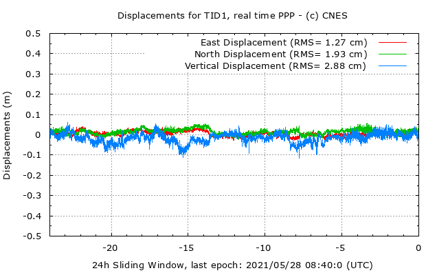
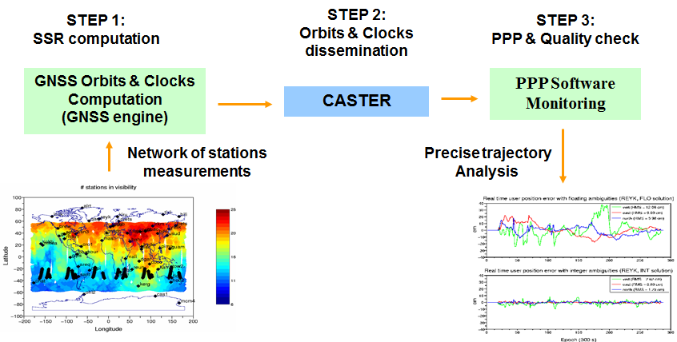

> __Customer__\: Centre National d'Études Spatiales (CNES)

> __Programme__\: Generic

> __Supply Chain__\: CNES >  CS Group SPACE

# Context

PPP WIZARD ODTS : The PPP-WIZARD demonstrator is a 'proof of concept' of the zero-difference ambiguity resolution method developed and patented by CNES.
PPP USER : The PPP-User uses corrections from the PPP-Wizard demonstrator or from another IGS analysis center and GNSS (GPS, Glonass, Galileo, BeiDou) measurements to compute the user position within 1cm accuracy (in real or non-real time).

CS Group responsabilities for Precise Point Positioning With Integer and Zero-difference Ambiguity Resolution Demonstrator are as follows:
* Maintenance and software developments.
* Maintenance of the operational pipeline producin correction streams.
* Maintenance of the platform for online services (correction data streams).
* GNSS study analysis.

The features are as follows:
* **PPP-WIZARD :** Real-time orbit determination and Time synchronisation  and computation of clock and phases biaises for multiple constellations based on a station network
*     Connection to data streams from IGS and REGINA, EUREF and AUSCOR. Broadcasting of computed products in SSR formats
	**USER :** Centimetric-level user position computation software, based on ODTS products.
*     Monitoring ODTS corrections. Automatic calculation of reference stations positions

# Project implementation

The project objectives are as follows:
* Development, maintenance and surveillance of the PPP-WIZARD ODTS.
* Development and maintenance of the PPP USER software.
* Analysis : Impact of ionosphere and station networks
* Analysis: HAS Galileo service performance

The processes for carrying out the project are:
* V cycle

# Technical characteristics

The solution key points are as follows:
* C++ 
* Computation of ODTS corrections
* Transmission of correction data stream through a caster
* Use of these corrections by the PPP USER

The main technologies used in this project are:

{:class="table table-bordered table-dark"}
| Domain | Technology(ies) |
|--------|----------------|
|Hardware environment(s)|OVH server|
|Operating System(s)|Linux - Debian|
|Programming language(s)|C++ / Shell / Python|
|Production software (IDE, DEVOPS etc.)|Scilab ; BNC; GIT|

{::comment}Abbreviations{:/comment}

*[CLI]: Command Line Interface
*[IaC]: Infrastructure as Code
*[PaaS]: Platform as a Service
*[VM]: Virtual Machine
*[OS]: Operating System
*[IAM]: Identity and Access Management
*[SIEM]: Security Information and Event Management
*[SSO]: Single Sign On
*[IDS]: intrusion detection
*[IPS]: intrusion prevention
*[NSM]: network security monitoring
*[DRMAA]: Distributed Resource Management Application API is a high-level Open Grid Forum API specification for the submission and control of jobs to a Distributed Resource Management (DRM) system, such as a Cluster or Grid computing infrastructure.
