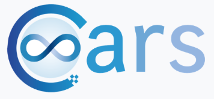

> __Customer__\: Centre National d'Etudes Spatiales (CNES)

> __Programme__\: CO3D

> __Supply Chain__\: CNES >  CS Group SPACE

# Context

CARS enables 3D reconstruction using photogrammetry. The tool is integrated into the ground segment of the CO3D mission.
This study aims to improve the denoising of point clouds produced by CARS for 3D scene reconstruction.
This is a follow-up of a 2022 study. Three areas for improvement were investigated, one of which was integrated into the PANDORA tool.

CS Group responsabilities for Denoising point clouds in epipolar geometry using confidence intervals  are as follows:
* Research and software development

The features are as follows:
* The goal is to remove noise while preserving important details, to improve the DSM output.
* Three improvements were tested: 1 - Optimizing the cost volume by SGM regularization, 2 - Bilateral filtering at the disparity map level, and 3 - Selecting secondary peaks from the cost profile when calculating the disparity map.
* Method 2 yielded good results and has been integrated into PANDORA. The other methods remain to be further developed.

# Project implementation

The project objectives are as follows:
* Improving CARS point cloud denoising methods
* Improving CARS output MNS
* 3D scene reconstruction by photogrammetry

The processes for carrying out the project are:
* Agile

# Technical characteristics

The solution key points are as follows:
* Gitlab

The main technologies used in this project are:

{:class="table table-bordered table-dark"}
| Domain | Technology(ies) |
|--------|----------------|
|Operating System(s)|Linux|
|Programming language(s)|Python|
|Production software (IDE, DEVOPS etc.)|Git, CARS, PANDORA|

{::comment}Abbreviations{:/comment}

*[CLI]: Command Line Interface
*[IaC]: Infrastructure as Code
*[PaaS]: Platform as a Service
*[VM]: Virtual Machine
*[OS]: Operating System
*[IAM]: Identity and Access Management
*[SIEM]: Security Information and Event Management
*[SSO]: Single Sign On
*[IDS]: intrusion detection
*[IPS]: intrusion prevention
*[NSM]: network security monitoring
*[DRMAA]: Distributed Resource Management Application API is a high-level Open Grid Forum API specification for the submission and control of jobs to a Distributed Resource Management (DRM) system, such as a Cluster or Grid computing infrastructure.
