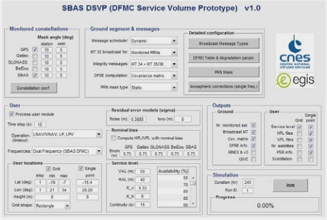
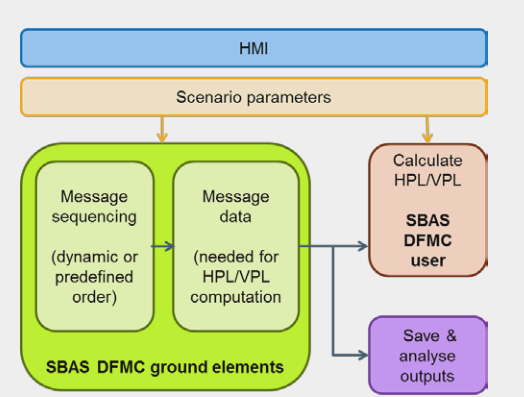

> __Customer__\: Centre National d'Études Spatiales (CNES)

> __Programme__\: Generic

> __Supply Chain__\: CNES >  CS Group SPACE

# Context

SCOPE is a tool used to support the SBAS (Satellite Based Augmentation System) DFMC (Dual Frequency Multi Constellation) standarisation and perfomance analysis activities.

CS Group responsabilities for SBAS Coverage Operational Performance Estimator are as follows:
* Maintenance and software development.
* Study analysis.

The features are as follows:
* Computation of Horizontal and Vertical Protection Levels (HPL/VPL) for the user from SBAS L1 and L5 messages computed by the ground module of the software.
* RINEX file generation.
* Usage of real SBAS L1 and L5 messages for volume protection Level monitoring.

# Project implementation

The project objectives are as follows:
* Development, maintenance of the SCOPE software and HMI.

The processes for carrying out the project are:
* V cycle

# Technical characteristics

The solution key points are as follows:
* Space segment : Computation of GNSS and SBAS satellites positions
* Ground segement : SBAS messages generation
* User segment : Computation of protection levels
* Analyse output : KPIs

The main technologies used in this project are:

{:class="table table-bordered table-dark"}
| Domain | Technology(ies) |
|--------|----------------|
|Operating System(s)|Windows - Linux|
|Programming language(s)|Matlab|

{::comment}Abbreviations{:/comment}

*[CLI]: Command Line Interface
*[IaC]: Infrastructure as Code
*[PaaS]: Platform as a Service
*[VM]: Virtual Machine
*[OS]: Operating System
*[IAM]: Identity and Access Management
*[SIEM]: Security Information and Event Management
*[SSO]: Single Sign On
*[IDS]: intrusion detection
*[IPS]: intrusion prevention
*[NSM]: network security monitoring
*[DRMAA]: Distributed Resource Management Application API is a high-level Open Grid Forum API specification for the submission and control of jobs to a Distributed Resource Management (DRM) system, such as a Cluster or Grid computing infrastructure.
