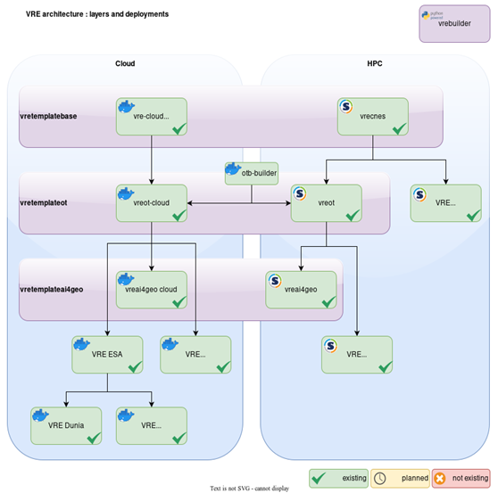
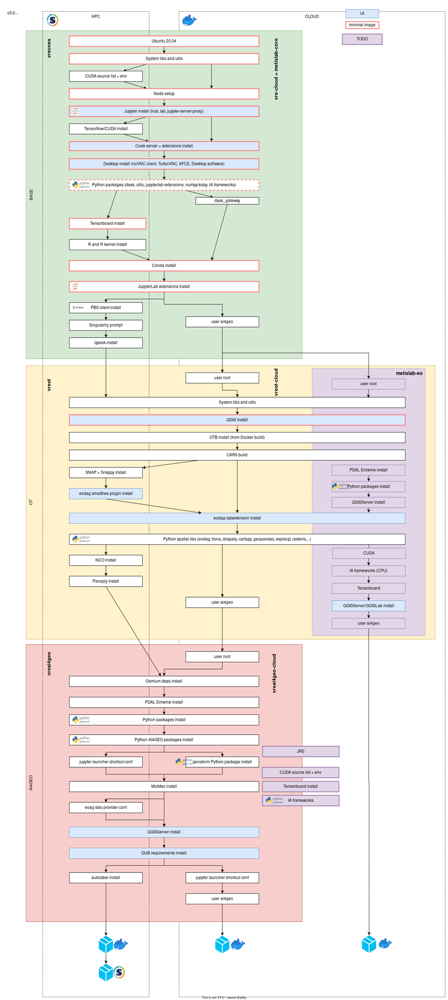

> __Customer__\: Centre National d'Etudes Spatiales (CNES)

> __Programme__\: Generic

> __Supply Chain__\: CNES >  CS Group SPACE

# Context

The Virtual Research Environment (VRE) is a containerized platform designed to provide scientists with a comprehensive, ready-to-use workspace for EO data analysis.

CS Group responsabilities for VRE are as follows:
* Design, development, integration, studies, calibrations, maintenance

The features are as follows:
* Containerized Deployment, JupyterLab Interface, Remote Desktop Access, Pre-configured Tools, Cloud & HPC Compatibility

# Project implementation

The project objectives are as follows:
* VRE's main objective is to simplify the setup of research environments to facilitate large-scale data processing

The processes for carrying out the project are:
* Agile

# Technical characteristics

The solution key points are as follows:
* Docker

The main technologies used in this project are:

{:class="table table-bordered table-dark"}
| Domain | Technology(ies) |
|--------|----------------|
|Hardware environment(s)|marker _ PC|
|Operating System(s)|marker _ Linux|
|Programming language(s)|marker _ Bash, Python, Docker|
|Production software (IDE, DEVOPS etc.)|marker _ Jupyter Notebook, QGIS, GDAL|

{::comment}Abbreviations{:/comment}

*[CLI]: Command Line Interface
*[IaC]: Infrastructure as Code
*[PaaS]: Platform as a Service
*[VM]: Virtual Machine
*[OS]: Operating System
*[IAM]: Identity and Access Management
*[SIEM]: Security Information and Event Management
*[SSO]: Single Sign On
*[IDS]: intrusion detection
*[IPS]: intrusion prevention
*[NSM]: network security monitoring
*[DRMAA]: Distributed Resource Management Application API is a high-level Open Grid Forum API specification for the submission and control of jobs to a Distributed Resource Management (DRM) system, such as a Cluster or Grid computing infrastructure.
