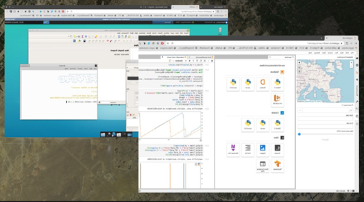
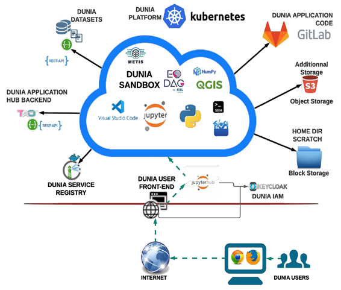

> __Customer__\: European Space Agency (ESA)

> __Programme__\: Copernicus

> __Supply Chain__\: ESA > GEOVILLE >  CS Group SPACE

# Context

Access and exploitation of the Copernicus Sentinels data remains the lowest by African users, reinforcing the need for a solution offering a variety of datasets, capable tools, a powerful infrastructure compatible with low-bandwidth requirements.

CS Group responsabilities for EO Africa DUNIA are as follows:
* Design, development, intégration, maintenance, training materials

The features are as follows:
* Main features: 
	    * Virtual Research Environment
	   * Open-source software solutions
	   * Jupyter Hub 
	   * Virtual desktop
	   * Image processing software
	   * EO data access
	   * EO training materials

# Project implementation

The project objectives are as follows:
* The Dunia Service shall contribute to the improvement of data accessibility and exploitation, facilitating development and operations of applications over Africa by giving access to Copernicus Sentinels data for Africa in formats and protocols adapted to low bandwidth and fast data exploitation.

The processes for carrying out the project are:
* V-Cycle

# Technical characteristics

The solution key points are as follows:
* Kubernetes, Docker

The main technologies used in this project are:

{:class="table table-bordered table-dark"}
| Domain | Technology(ies) |
|--------|----------------|
|Hardware environment(s)|marker _ PC|
|Operating System(s)|marker _ Linux|
|Programming language(s)|marker _ Python|
|Production software (IDE, DEVOPS etc.)|marker _ Docker, Kubernetes, Jupyter notebooks, QGIS, SNAP|

{::comment}Abbreviations{:/comment}

*[CLI]: Command Line Interface
*[IaC]: Infrastructure as Code
*[PaaS]: Platform as a Service
*[VM]: Virtual Machine
*[OS]: Operating System
*[IAM]: Identity and Access Management
*[SIEM]: Security Information and Event Management
*[SSO]: Single Sign On
*[IDS]: intrusion detection
*[IPS]: intrusion prevention
*[NSM]: network security monitoring
*[DRMAA]: Distributed Resource Management Application API is a high-level Open Grid Forum API specification for the submission and control of jobs to a Distributed Resource Management (DRM) system, such as a Cluster or Grid computing infrastructure.
