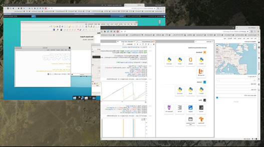
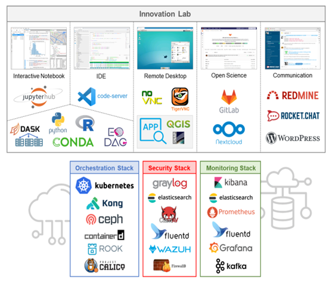

> __Customer__\: European Space Agency (ESA)

> __Programme__\: Copernicus

> __Supply Chain__\: ESA > ITC - U. TWENTE >  CS Group SPACE

# Context

EO AFRICA R&D Facility is a flagship initiative of EO AFRICA with an overarching long term (>10 years) goal of supporting an African European collaboration to enable an active research community and creative innovation processes for a continuous development of EO capabilities in Africa.

CS Group responsabilities for EO Africa R&D Facility are as follows:
* Design, development, intégration, maintenance, training materials

The features are as follows:
* Main features: 
	    * Virtual Research Environment
	   * Open-source software solutions
	   * Jupyter Hub 
	   * Virtual desktop
	   * Image processing software
	   * EO data access
	   * EO training materials

# Project implementation

The project objectives are as follows:
* Build an African-European R&D partnership to facilitate sustainable adoption of EO and related space technologies in Africa, in harmony with the “Agenda 2063 – The Africa we want" of the African Union Commission (AUC).

The processes for carrying out the project are:
* V-Cycle

# Technical characteristics

The solution key points are as follows:
* Kubernetes, Docker

The main technologies used in this project are:

{:class="table table-bordered table-dark"}
| Domain | Technology(ies) |
|--------|----------------|
|Hardware environment(s)|marker _ PC|
|Operating System(s)|marker _ Linux|
|Programming language(s)|marker _ Python|
|Production software (IDE, DEVOPS etc.)|marker _ Docker, Kubernetes, Jupyter notebooks, QGIS, SNAP|

{::comment}Abbreviations{:/comment}

*[CLI]: Command Line Interface
*[IaC]: Infrastructure as Code
*[PaaS]: Platform as a Service
*[VM]: Virtual Machine
*[OS]: Operating System
*[IAM]: Identity and Access Management
*[SIEM]: Security Information and Event Management
*[SSO]: Single Sign On
*[IDS]: intrusion detection
*[IPS]: intrusion prevention
*[NSM]: network security monitoring
*[DRMAA]: Distributed Resource Management Application API is a high-level Open Grid Forum API specification for the submission and control of jobs to a Distributed Resource Management (DRM) system, such as a Cluster or Grid computing infrastructure.
